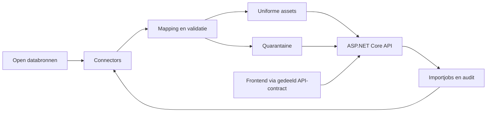

# Backendarchitectuur en infoschema

## Backendwerkstroom en integratie

De backend wordt gebouwd met C# en ASP.NET Core en beheert bron-IO, mappingversies, jobs, transacties, toegangscontrole en kwaliteitsberekeningen. De frontend gebruikt de API. De backenddocumentatie bevat geen frontendframework, schermontwerp of frontendplanning.

Het [API-contract](../../docs/api-contract.md) is het gedeelde afstemmingspunt en blijft concept totdat de integratieafspraken zijn bevestigd. Origin, authenticatiestroom, hosting en eventuele proxy worden in D03 afgestemd.

## Voorgestelde rollen en opslag

Azure App Service en Azure SQL zijn ontwerpvoorstellen. Hosting, duurzame jobuitvoering en benodigde ruimtelijke queries worden in de review beoordeeld. Entra ID bepaalt minimaal de rollen Analyst en Admin. De backend controleert rechten per actie. Managed identity geeft toegang tot Key Vault volgens het beginsel van minimale rechten. Backendgeheimen gaan niet naar de browser. Frontend- en ArcGIS-toegang zijn nog af te stemmen integratiepunten.

## Kernentiteiten

| Entiteit | Voorgestelde velden |
| --- | --- |
| ImportJob | jobId, operator, dataset, discipline, bbox, mappingVersion, status, submittedBy, submittedAt, startedAt, finishedAt, counts, retryOf |
| Asset | assetId, operator, sourceDataset, sourceRecordId (verplicht voor de eerste Liander-import), discipline, assetType, voltageClass, voltageKv optioneel, material optioneel, geometry, jobId |
| QuarantineRecord | jobId, recordReference, reasonCode, field optioneel, veilige samenvatting |
| DatasetSnapshot | operator, dataset, peildatum indien bekend, opgehaaldOp, gepubliceerdeJobId |

Onbekende kenmerken blijven expliciet onbekend. De connector leest het vastgestelde bron-CRS. De mapping normaliseert geometrie en geeft ongeldige invoer een foutcode. GeoJSON aan de API-grens gebruikt WGS84 met lengtegraad vóór breedtegraad. Voor lengtes en oppervlakken is een geschikte metrische projectie of geodetische berekening nodig. Herkenning tussen publicaties zonder betrouwbare bron-ID is nog een open ontwerpvraag.

Verwerking gebruikt begrensde concurrency, annuleerbare workers en veilige aggregatie van aantallen. Elke poging krijgt een eigen job-ID en verwijst bij retry naar de vorige poging. Een complete succesvolle datasetversie wordt atomair gepubliceerd. De vorige gepubliceerde versie blijft beschikbaar als een poging faalt of wordt geannuleerd. Meerdere workers mogen dezelfde job niet dubbel claimen.

[GeoJSON en WGS84 in ArcGIS](https://developers.arcgis.com/javascript/latest/display-projected-geometries/) · [Key Vault-referenties voor App Service](https://learn.microsoft.com/azure/app-service/app-service-key-vault-references)

## D02 — Mapping van de eerste import

De gekozen Liander-LS-selectie, veldmapping, handmatige controles en quarantaine- en kwaliteitsregels staan in het [backenddatasheet](datasheet.md#d02--eerste-import-liander-laagspanning). Dit zijn vastgelegde ontwerpkeuzes; de ontwerpreview en implementatie zijn nog niet afgerond. Volledige kabelgeometrie wordt als MultiLineString gebruikt; onbekende spanning, materiaal en peildatum blijven expliciet onbekend.

D03 omvat onder meer de beoordeling van opslag-CRS, transformatie, assetherkenning tussen publicaties, mappingversie, API-bbox-CRS, jobuitvoering en integratie met de frontend.
