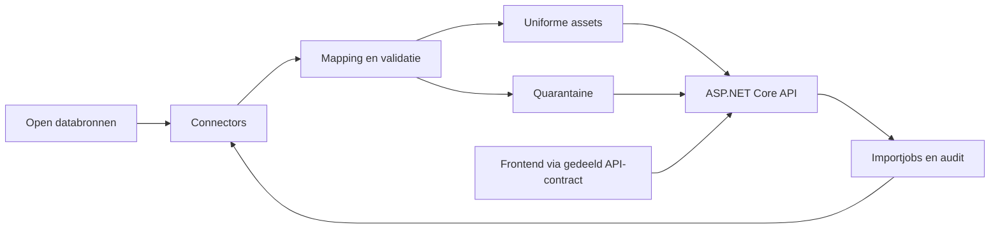

# Backendarchitectuur en infoschema

## Backendwerkstroom en integratie

De backend wordt ontworpen met C# en ASP.NET Core en gaat de volgende onderdelen beheren: bron-IO, mappingversies, jobs, transacties, toegangscontrole en kwaliteitsberekeningen. De frontend gebruikt de API. De backenddocumentatie bevat geen frontendframework, schermontwerp of frontendplanning.

Het [API-contract](../../docs/api-contract.md) is het gedeelde afstemmingspunt en blijft concept totdat de integratieafspraken zijn bevestigd. Origin, authenticatiestroom, hosting en eventuele proxy worden in D03 afgestemd.

## Voorgestelde rollen en opslag

Azure App Service en Azure SQL zijn ontwerpvoorstellen. Hosting, duurzame jobuitvoering en benodigde ruimtelijke queries worden in de review beoordeeld. Entra ID bepaalt minimaal de rollen Analyst en Admin. De backend controleert rechten per actie. Managed identity geeft toegang tot Key Vault volgens het beginsel van minimale rechten. Backendgeheimen gaan niet naar de browser. Frontend- en ArcGIS-toegang zijn nog af te stemmen integratiepunten.

## Kernentiteiten

| Entiteit | Voorgestelde velden |
| --- | --- |
| ImportJob | jobId, operator, dataset, discipline, bbox, mappingVersion, status, submittedBy, submittedAt, startedAt, finishedAt, counts, retryOf |
| Asset | assetId, operator, sourceDataset, sourceRecordId (verplicht voor de eerste Liander-import), discipline, assetType, voltageClass, voltageKv optioneel, material optioneel, geometry, jobId |
| QuarantineRecord | jobId, recordReference, reasonCode, field optioneel, veilige samenvatting |
| DatasetSnapshot | operator, dataset, peildatum indien bekend, opgehaaldOp, gepubliceerdeJobId |

Onbekende kenmerken blijven expliciet onbekend. De connector leest het vastgestelde bron-CRS. De mapping normaliseert geometrie en geeft ongeldige invoer een foutcode. GeoJSON aan de API-grens gebruikt WGS84 met lengtegraad vóór breedtegraad. Voor lengtes en oppervlakken is een geschikte metrische projectie of geodetische berekening nodig. Herkenning tussen publicaties zonder betrouwbare bron-ID is nog een open ontwerpvraag.

Verwerking gebruikt begrensde concurrency, annuleerbare workers en veilige aggregatie van aantallen. Elke poging krijgt een eigen job-ID en verwijst bij retry naar de vorige poging. Een complete succesvolle datasetversie wordt atomair gepubliceerd. De vorige gepubliceerde versie blijft beschikbaar als een poging faalt of wordt geannuleerd. Meerdere workers mogen dezelfde job niet dubbel claimen.

[GeoJSON en WGS84 in ArcGIS](https://developers.arcgis.com/javascript/latest/display-projected-geometries/) · [Key Vault-referenties voor App Service](https://learn.microsoft.com/azure/app-service/app-service-key-vault-references)

## D02 — Mapping van de eerste import

De gekozen Liander-LS-selectie, veldmapping, handmatige controles en quarantaine- en kwaliteitsregels staan in het [backenddatasheet](datasheet.md#d02--eerste-import-liander-laagspanning). Dit zijn huidige ontwerpkeuzes; de volledige ontwerpreview en implementatie zijn nog niet afgerond. Bij nieuwe inzichten kunnen de keuzes met onderbouwing worden herzien. Volledige kabelgeometrie wordt als MultiLineString gebruikt; onbekende spanning, materiaal en peildatum blijven expliciet onbekend.

RD New als intern CRS, MultiLineString, NetTopologySuite en mappingversie liander-lv-v1 zijn inmiddels gekozen voor de lokale Liander-proef. Voor de eerste visualisatieproef is een afzonderlijke ProjNET-transformer gebouwd. D03 omvat nog databaseopslag, verdere beoordeling van de transformatienauwkeurigheid en API-koppeling, assetherkenning tussen publicaties, API-bbox-CRS, jobuitvoering en integratie met de frontend.

## Eerste bouwstap: lokale B01-proef

De lokale proef is gebouwd als één ASP.NET Core Web API-project op .NET 10 onder `backend/NetUnify.Api/`. Deze indeling houdt de eerste versie overzichtelijk en onafhankelijk van de frontend.

| Onderdeel | Rol in de proef |
| --- | --- |
| `JobsController` | Ontvangt GET /api/v1/jobs en geeft HTTP-status en antwoord terug |
| `JobService` | Levert en sorteert vaste fictieve jobs |
| DTO's onder `Contracts/` | Beschrijven de afgesproken JSON-velden; DTO betekent data transfer object |

De klasse `JobsController` staat momenteel in `Controllers/JobController.cs`. `JobService` wordt in `Program.cs` via `AddScoped` geregistreerd. De DTO's staan in `Contracts/JobDto.cs` en `Contracts/JobsResponseDto.cs`.

Bijvoorbeeld: een GET-verzoek komt bij de controller binnen. De controller vraagt de service om jobs en retourneert het DTO-antwoord met HTTP 200. De controller bevat geen Liander-query, mapping of databasecode. Later kan de bron van jobgegevens veranderen zonder dat de antwoordvorm noodzakelijk hoeft te veranderen.

Deze proef bouwt nog geen connector, database, jobworker of rolbeveiliging. De rollen en verwerkingsarchitectuur in dit document blijven het beoogde vervolg. Ze zijn geen reeds aanwezige garanties. Details en gerichte controles staan in [B01: lokale jobsproef](b01-jobsproef.md).

## Lokale B02-verwerking

De ontwikkelroute `/dev/liander/sample` in Program.cs is beschikbaar in Development. De route haalt via LianderConnector de vaste D02-selectie op, verwerkt deze via LianderImportProcessor en toont mappingversie, tellingen, balans en afkeurmeldingen. De HTTP-client is met AddHttpClient geregistreerd.

| Onderdeel | Huidige verantwoordelijkheid |
| --- | --- |
| Connectors/LianderConnector.cs | Vaste ArcGIS-query en controle op HTTP-/bronfout en afgekapt antwoord |
| Mapping/LianderAssetMapper.cs | Bron-ID, vaste assetkenmerken en mappingversie liander-lv-v1 |
| Mapping/LianderGeometryMapper.cs | Lijnstructuurcontroles en MultiLineString in RD met SRID 28992 |
| Services/LianderImportProcessor.cs | Alle dubbele ID's afkeuren, assets mappen en quarantaine verzamelen |
| Models/Asset.cs | Uniform assetmodel in geheugen |
| Models/ImportResult.cs | Resultaat met jobId, mappingVersion, read, assets en quarantaine |
| NetUnify.Api.Tests/UnitTest1.cs | 15 vaste xUnit-scenario's voor mapping, afkeur, tellingen en geometriebehoud |
| Mapping/RdToWgs84Transformer.cs | Afzonderlijke RD-naar-WGS84-uitvoerkopie met ProjNET 2.1.0; nog niet aangesloten op de API |
| NetUnify.Api.Tests/RdToWgs84TransformerTests.cs | 3 tests voor referentiepunt, geometriebehoud, meerdere paden en verkeerd invoer-SRID |

De ontwikkelaar bevestigde de live verwerking van 23 records en 15 geslaagde automatische tests. Details, beperkingen en het NSGI-referentiepunt staan in het [datasheet](datasheet.md#b02--lokale-liander-verwerking-gecontroleerd-op-24-november-2026).

De interne geometrie gebruikt NetTopologySuite 2.6.0, MultiLineString en RD New. Voor kaartuitvoer is een getransformeerde kopie afgesproken, met ETRS89 gelijkgesteld aan WGS84 voor visualisatie. De afzonderlijke transformer gebruikt ProjNET 2.1.0 met een WKT-definitie en een zevenparameter-datumtransformatie naar WGS84. Deze benadering is geen volledige RDNAPTRANS-implementatie. De ontwikkelaar bevestigde inmiddels 18 geslaagde tests, waaronder het NSGI-referentiepunt binnen een voorlopige tolerantie van 0.00001 graad per as. Verdere nauwkeurigheidscontrole en aansluiting op de API volgen. Het JSON van de ontwikkelroute bevat alleen een verwerkingssamenvatting; GeoJSON-uitvoer is vervolgwerk.

De lokale proef gebruikt een vast fictief job-ID en genereert nieuwe asset-ID's per aanroep. Het fictieve jobs-endpoint blijft een afzonderlijke B01-proef. Duurzame jobs, opslag, herhaalbaarheid tussen pogingen, snapshots, export en autorisatie vragen vervolgimplementatie. De volledige D03-review blijft open.
