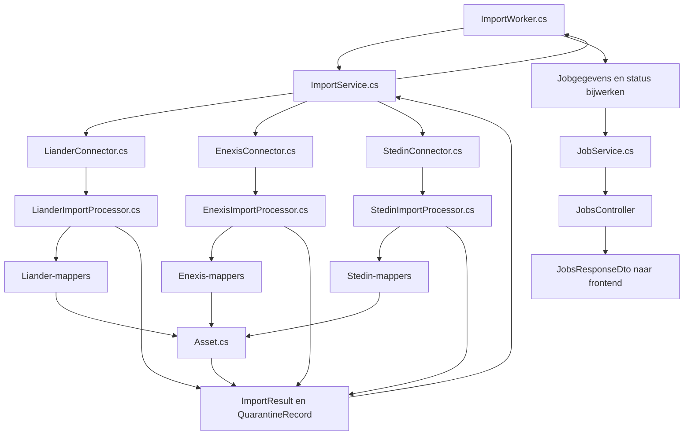

# Eenvoudige bestandsschets backend

Deze schets laat zien hoe de C#-bestanden voor de drie importbronnen kunnen samenwerken. Het is een herzienbaar startontwerp. De Liander-proef en fictieve jobs zijn aanwezig; Enexis, Stedin en echte jobuitvoering worden later aangesloten.

**Open liggingsdata voor analyse en demonstratie. Geen KLIC en geen informatie voor graafveiligheid.**

## Bestanden en verantwoordelijkheden

De genoemde locaties vallen onder backend/NetUnify.Api/.

| Bestand of bestanden | Eenvoudige verantwoordelijkheid | Stand |
| --- | --- | --- |
| Program.cs | Start de applicatie, registreert services en koppelt routes | Aanwezig; bevat de lokale Liander-sample- en GeoJSON-route |
| Controllers/JobController.cs | JobsController ontvangt HTTP-verzoeken en geeft jobgegevens terug | Aanwezig voor GET /api/v1/jobs |
| Services/JobService.cs | Levert het jobsoverzicht; later ook aanspreekpunt voor echte jobgegevens | Levert nu vaste fictieve jobs |
| Services/ImportService.cs | Kiest op basis van de bron de connector en processor en verzamelt het resultaat | Voorstel voor gezamenlijke aansturing |
| Services/ImportWorker.cs | Voert ingeplande importjobs uit en werkt hun voortgang bij | Voorstel voor latere jobuitvoering |
| Connectors/LianderConnector.cs | Haalt Liander-JSON op via ArcGIS REST en controleert CRS-metadata voor het uitlezen van features | Aanwezig voor de vaste bbox; 14 connector-CRS-testgevallen |
| Connectors/EnexisConnector.cs | Haalt JSON op uit de onderzochte provinciale ArcGIS-publicatie | Voorstel; dekking en categorie nog afstemmen |
| Connectors/StedinConnector.cs | Downloadt en leest de samenhangende shapefile-bestanden | Voorstel; concrete leesbibliotheek nog kiezen |
| Mapping/LianderAssetMapper.cs en LianderGeometryMapper.cs | Lezen bronvelden, controleren lijnpaden en maken uniforme assets | Aanwezig |
| Mapping/RdToWgs84Transformer.cs | Maakt met ProjNET 2.1.0 een WGS84-kopie van RD-lijnpaden | Aanwezig, getest en aangesloten op Development-routes via AssetGeoJsonMapper |
| Mapping/AssetGeoJsonMapper.cs | Maakt een FeatureCollection van assets met een getransformeerde geometriekopie | Aanwezig; twee mappertests en lokale HTTP-uitvoer gecontroleerd |
| Mapping/EnexisAssetMapper.cs en EnexisGeometryMapper.cs | Zetten Enexis-velden en geometrie om naar hetzelfde assetmodel | Voorstel |
| Mapping/StedinAssetMapper.cs en StedinGeometryMapper.cs | Zetten Stedin-attributen en geometrie om naar hetzelfde assetmodel | Voorstel |
| Services/LianderImportProcessor.cs | Controleert dubbele bron-ID's en verzamelt assets en afkeurmeldingen | Aanwezig |
| Services/EnexisImportProcessor.cs en StedinImportProcessor.cs | Verwerken een bronselectie met de brongebonden mapper en validatie | Voorstel; gedeelde logica kan bij de bouw worden hergebruikt |
| Models/Asset.cs | Beschrijft de uniforme kabelgegevens | Aanwezig; hetzelfde doelmodel voor alle drie bronnen |
| Models/ImportResult.cs | Beschrijft resultaat, mappingversie en afkeurmeldingen | Aanwezig; bevat ook QuarantineRecord |
| Contracts/JobDto.cs en JobsResponseDto.cs | Beschrijven de gegevens die de jobs-API teruggeeft | Aanwezig; JobDto.cs bevat ook JobCountsDto |

## Beoogde verbinding tussen de drie importpaden

De pijlen geven aan welk onderdeel het volgende onderdeel aanroept of van gegevens voorziet. ImportService, ImportWorker en de Enexis-/Stedin-bestanden zijn voorstellen.

Bijvoorbeeld, een toekomstige Liander-job laat de worker via ImportService de Liander-connector aanroepen. De processor controleert de ontvangen records en gebruikt de mappers voor de omzetting. De uitkomst bevat geaccepteerde assets, afkeurmeldingen en tellingen. De worker koppelt die uitkomst aan de jobstatus. Enexis en Stedin krijgen dezelfde route met hun eigen bronlezers en mappers.

## Wat is nu verbonden?

| Lokale ingang | Huidige aanroepketen | Uitkomst |
| --- | --- | --- |
| GET /api/v1/jobs | JobsController → JobService → JobsResponseDto | Drie vaste fictieve jobs |
| GET /dev/liander/sample | Route in Program.cs → LianderConnector → LianderImportProcessor → Liander-mappers; daarna AssetGeoJsonMapper → RdToWgs84Transformer | Samenvatting, coördinatenvoorbeeld en GeoJSON-collectie |
| GET /dev/liander/geojson | Route in Program.cs → LianderConnector → LianderImportProcessor → Liander-mappers; daarna AssetGeoJsonMapper → RdToWgs84Transformer | Rechtstreeks FeatureCollection met application/geo+json |

De Liander-controleroute gebruikt een vast voorbeeld-job-ID. Het fictieve jobsoverzicht en de live bronverwerking zijn op dit moment afzonderlijke controles. Echte jobplanning, statusopslag en de koppeling via worker en ImportService volgen later.

## Gedeelde afspraken

Alle bronnen gaan naar hetzelfde Asset-model. Iedere bron krijgt eigen lees- en mappingregels, een mappingversie en herleidbare bron-ID's. Intern is RD New met MultiLineString gekozen. RdToWgs84Transformer maakt al een afzonderlijke uitvoerkopie met SRID 4326 en lengtegraad vóór breedtegraad. De ontwikkelaar bevestigde drie transformatietests, twee GeoJSON-mappertests en inmiddels 34 geslaagde tests in totaal, inclusief 14 connector-CRS-testgevallen. De connector vereist wkid 28992 en controleert een eventueel aanwezige latestWkid eveneens op 28992. Na deze wijziging bevestigde de ontwikkelaar via /dev/liander/sample mappingVersion liander-lv-v1, 23 gelezen, 23 geaccepteerd, 0 in quarantaine, countsBalance true en errors []. Ook /dev/liander/geojson is na de wijziging opnieuw door de ontwikkelaar gecontroleerd: HTTP 200, application/geo+json, FeatureCollection en 23 features. De transformer maakt via AssetGeoJsonMapper deel uit van de twee Development-routes hierboven. Een kaartclient en het publieke assets-endpoint zijn nog niet gekoppeld. De opslagkeuze en manier van jobuitvoering worden verder uitgewerkt tijdens de review.

Het [gegevensoverzicht](gegevensoverzicht.md) beschrijft de gegevens. Het [datasheet](datasheet.md) bevat bronfeiten en controles. De [architectuur](architectuur.md) bevat de verdere ontwerpvragen.
