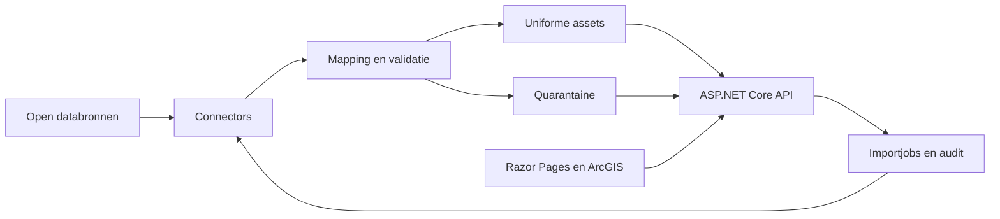

# Architectuur en infoschema

## Grenzen tussen backend en frontend

De backend beheert bron-IO, mappingversies, jobs, transacties, toegangscontrole en kwaliteitsberekeningen. De frontend toont de API-uitkomsten en stuurt acties via het contract. Voor de eerste slice gebruik ik één repo en twee ASP.NET Core-projecten. Razor Pages is het voorstel omdat de eerste schermen vooral formulieren, tabellen en kaartinteractie gebruiken. Ik wil de browser via dezelfde origin laten werken en werk in de review uit of een reverse proxy of weblaag de API-aanroepen doorgeeft. ArcGIS draait in de browser.

## Voorgestelde rollen en opslag

Azure App Service en Azure SQL zijn ontwerpvoorstellen. Ik onderzoek in de review hoe ik de twee applicaties host, duurzame jobs uitvoer en welke ruimtelijke queries ik nodig heb. Entra ID bepaalt minimaal de rollen Analyst en Admin. De backend controleert rechten per actie. Managed identity geeft toegang tot Key Vault volgens het beginsel van minimale rechten. Voor ArcGIS leg ik de vereiste licentie, toegestane origins, toegang tot de basemap en bronvermelding vast. Een browsercredential behandel ik als zichtbaar en beperk ik waar de provider dat ondersteunt. Backendgeheimen gaan niet naar de browser.

## Kernentiteiten

| Entiteit | Voorgestelde velden |
| --- | --- |
| ImportJob | jobId, operator, dataset, discipline, bbox, mappingVersion, status, submittedBy, submittedAt, startedAt, finishedAt, counts, retryOf |
| Asset | assetId, operator, sourceDataset, sourceRecordId indien beschikbaar, discipline, assetType, voltageClass, voltageKv optioneel, material optioneel, geometry, jobId |
| QuarantineRecord | jobId, recordReference, reasonCode, field optioneel, veilige samenvatting |
| DatasetSnapshot | operator, dataset, peildatum indien bekend, opgehaaldOp, gepubliceerdeJobId |

Ik bewaar onbekende kenmerken als onbekend. De connector leest het vastgestelde bron-CRS. De mapping normaliseert geometrie en geeft ongeldige invoer een foutcode. GeoJSON aan de API-grens gebruikt WGS84 met lengtegraad vóór breedtegraad. Voor lengtes en oppervlakken kies ik een geschikte metrische projectie of een geodetische berekening. Zonder betrouwbare bron-ID bepaal ik tijdens de bronproef hoe versies herkenbaar blijven.

Verwerking gebruikt begrensde concurrency, annuleerbare workers en veilige aggregatie van aantallen. Elke poging krijgt een eigen job-ID en verwijst bij retry naar de vorige poging. Ik publiceer een complete succesvolle datasetversie atomair. De vorige gepubliceerde versie blijft beschikbaar als een poging faalt of wordt geannuleerd. Meerdere workers mogen dezelfde job niet dubbel claimen.

[GeoJSON en WGS84 in ArcGIS](https://developers.arcgis.com/javascript/latest/display-projected-geometries/) · [Key Vault-referenties voor App Service](https://learn.microsoft.com/azure/app-service/app-service-key-vault-references)
